<h2 align="center">
  
  Hey Everyone, I'm Minh Thành
</h2>

  

- 👨‍💻 Building modern Full-Stack Web applications that solve real problems
- 🎓 Information Technology Student at **PTIT HCMC**
- 📖 Focused on **TypeScript, React, Node.js**, and clean software architecture
- 🛠️ Enjoy working on booking platforms, smart IoT dashboards & secure web systems
- 👥 Open to internships, freelance projects, and collaboration

  

  &nbsp;
  &nbsp;
  

 

---

  
   
  
  
   
  
  

  

    
  

  

---

  

